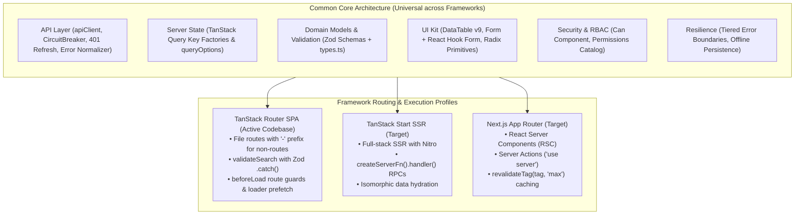

# Enterprise Frontend Architecture Guidelines

## Purpose

Build frontend systems that are:
- **Deletion-Safe**: Deleting a feature folder completely removes it without breaking the build or other features.
- **Domain-Driven**: Code is organized around business features, not generic technical layers.
- **Resilient & Fault-Tolerant**: Network failures, 401 token rotations, and unexpected component crashes are isolated and recovered gracefully.
- **Type-Safe End-to-End**: Zod schemas act as the single source of truth for validations and inferred types.
- **Offline-First & Responsive**: Cached queries render instantly with background revalidation and IndexedDB persistence.
- **Multi-Framework Ready**: Core domain architecture is common across frameworks, with explicit routing profiles for **TanStack Router SPA (Active)**, **TanStack Start SSR**, and **Next.js App Router**.

---

## 1. Multi-Framework Strategy & Architecture Profiles

The majority of enterprise frontend code—API clients, data models, validation schemas, query options, forms, tables, error boundaries, and RBAC—is **framework-agnostic**. The routing, SSR, and mutation dispatch mechanisms adapt per framework:



### Detailed Framework Profiles (See References)
- **[TanStack Router SPA Architecture](./references/lib-tanstack-router.md)**: The active implementation in `ethiomfi-frontend`.
- **[TanStack Start SSR Architecture](./references/framework-tanstack-start.md)**: The isomorphic full-stack SSR guide.
- **[Next.js App Router Architecture](./references/framework-nextjs.md)**: The React Server Components & Server Actions guide.

---

## 2. Forbidden Architectural Directories & Anti-Patterns

To preserve domain boundaries and prevent spaghetti coupling, agents **MUST NEVER** create the following:

### 1. Forbidden Top-Level Directories
```text
src/
├── features/        # FORBIDDEN: Features must live co-located under routes
├── services/        # FORBIDDEN: API calls live in feature -api.ts files
├── controllers/     # FORBIDDEN: Frontend is declarative; logic belongs in routes and hooks
├── models/          # FORBIDDEN: Data models belong in feature -schemas.ts and -types.ts
└── repositories/    # FORBIDDEN: Server state is managed via TanStack Query
```

### 2. Forbidden Boundary Violations
1. **Never Cross-Import Peer Features**: `src/routes/dashboard/members/` must **NEVER** import anything from `src/routes/dashboard/savings/`. Shared concepts must be promoted to `src/components/`, `src/api/`, `src/config/`, or `src/lib/`.
2. **Inward Dependencies Only**: Feature modules may only import from their own internal files or from the global common layer (`@/api`, `@/components`, `@/config`, `@/lib`, `@/stores`).
3. **Never Write Raw HTML Tables**: Never write raw `<table>`, `<tr>`, `<td>` elements in feature views. Always use the [`DataTable`](./references/data-table/data-table.md) abstraction.
4. **Never Write Raw HTML Forms**: Never use raw `<form>` tags or uncontrolled `<input>` elements in feature code. Always use the [`Form`](./references/forms/Form.md) and [`FormField`](./references/forms/FormField.md) abstractions.
5. **Never Import Raw Axios in Features**: Never import `axios` directly inside a feature. Always use the [`apiClient<T>()`](./references/api/client.md) factory from `@/api/client`.
6. **Never Store Tokens in localStorage or Client Stores**: Never store JWT access tokens in browser storage or client state stores. Tokens are stored exclusively in memory via [`tokenManager`](./references/api/token-manager.md).

---

## 3. Project Directory Layout

The application enforces strict separation between the **Common Layer** and **Feature Modules** (co-located under routes):

```text
src/
├── api/                    # COMMON: Base HTTP client, CircuitBreaker, token manager, error normalizer
├── components/             # COMMON: Reusable UI abstractions and primitives
│   ├── ui/                 # Atomic primitives (button, input, table, dialog, badge)
│   ├── forms/              # Form abstractions (Form, FormField, SelectField, SubmitButton)
│   ├── data-table/         # DataTable abstraction, pagination, search, filters
│   ├── guards/             # Security UI (Can, PermissionDenied, route-guards)
│   ├── layout/             # App shell (sidebar, header, breadcrumbs, skeletons)
│   └── error-boundary/     # Tiered crash fallbacks (ErrorBoundary, RouteErrorFallback)
├── config/                 # COMMON: Global constants, permissions catalog, navigation
├── hooks/                  # COMMON: Reusable React utility hooks (use-debounce, useAuth)
├── integrations/           # COMMON: QueryClient configuration, IndexedDB persistence, auth
├── lib/                    # COMMON: Utility helpers (cn, online check, validations)
├── stores/                 # COMMON: Global UI and profile client state (TanStack Store)
│
└── routes/                 # ROUTER & FEATURE MODULES
    ├── __root.tsx          # App shell, context provider, devtools
    ├── index.tsx           # Entry redirect
    ├── forbidden.tsx       # 403 Forbidden display
    ├── dashboard.tsx       # Dashboard shell with beforeLoad authentication
    └── dashboard/          # Authenticated feature routes
        ├── index.tsx       # Dashboard home
        ├── -components/    # Dashboard-wide components (sidebar, header)
        └── members/        # Feature Module: Members Domain
            ├── index.tsx   # Route page: Members list (/dashboard/members)
            ├── new.tsx     # Route page: Create member (/dashboard/members/new)
            ├── $memberId.tsx # Route page: Member detail (/dashboard/members/:memberId)
            ├── -api.ts     # Feature API client factory & custom actions
            ├── -queries.ts # Query key factories, queryOptions, mutation hooks
            ├── -schemas.ts # Zod validation schemas & inferred types
            ├── -types.ts   # Non-schema domain interfaces, filter params, props
            └── -components/# Feature-private components (columns, MemberForm)
```

---

## 4. Feature Module Anatomy & Contract

Every feature folder encapsulates everything required for that business capability:

```text
src/routes/dashboard/{feature-name}/
├── -api.ts        # Typed API endpoints using apiClient<Entity>('endpoint')
├── -queries.ts    # Query key factories, queryOptions(), mutation hooks
├── -schemas.ts    # Zod schemas (single source of truth) + inferred types
├── -types.ts      # TypeScript interfaces, non-schema types, param types, props
├── -stores.ts     # Optional local feature client state (TanStack Store)
├── -components/   # Feature-private components (tables, dialogs, forms)
├── index.tsx      # Feature list page
└── $id.tsx        # Feature detail page
```

> [!IMPORTANT]
> **The `-` Prefix in TanStack Router**: TanStack Router automatically treats all `.tsx` and `.ts` files under `src/routes` as routable endpoints **unless** they are prefixed with `-`. Therefore, all non-route files (`-api.ts`, `-queries.ts`, `-schemas.ts`, `-types.ts`, `-components/`) MUST begin with `-`.

---

## 5. Type Organization Rules

Separate schema-inferred contracts from non-schema domain types:

### 1. `schemas.ts` / `-schemas.ts` (Validation & Inferred Types)
Define validation schemas using Zod. Infer types directly using `z.infer<typeof ...>`:

```typescript
// src/routes/dashboard/members/-schemas.ts
import { z } from "zod";

export const memberSchema = z.object({
  id: z.string().uuid(),
  nationalIdFan: z.string().length(16),
  firstName: z.string().min(2),
  lastName: z.string().min(2),
  phoneNumber: z.string().min(9),
  clientType: z.enum(["INDIVIDUAL", "JOINT", "OTHER"]),
  status: z.enum(["ACTIVE", "PENDING", "SUSPENDED", "CLOSED"]),
});

export const createMemberSchema = memberSchema.omit({
  id: true,
  status: true,
});

export const updateMemberSchema = createMemberSchema.partial();

// Inferred types exported here:
export type MemberEntity = z.infer<typeof memberSchema>;
export type CreateMemberInput = z.infer<typeof createMemberSchema>;
export type UpdateMemberInput = z.infer<typeof updateMemberSchema>;
```

### 2. `types.ts` / `-types.ts` (Domain Contracts & Parameters)
Define search query parameters, component props, and non-schema domain contracts. Re-export inferred types for consumer convenience:

```typescript
// src/routes/dashboard/members/-types.ts
export type { MemberEntity, CreateMemberInput, UpdateMemberInput } from "./-schemas";

export interface MemberListParams {
  page?: number;
  limit?: number;
  search?: string;
  sort?: string;
  filter?: Record<string, string>;
}

export interface MemberIdentifier {
  id: string;
  type: string;
  value: string;
}

export interface MemberAddress {
  id: string;
  city: string;
  woreda: string;
  houseNumber?: string;
}
```

---

## 6. API Service & Network Resilience Layer

Feature modules **never** invoke raw HTTP clients. Features instantiate a typed client using the centralized `apiClient` factory:

```typescript
// src/routes/dashboard/members/-api.ts
import { apiClient } from "@/api/client";
import type {
  CreateMemberInput,
  MemberEntity,
  MemberListParams,
  UpdateMemberInput,
} from "./-types";

// Base client bound to the feature endpoint
const client = apiClient<MemberEntity>("members");

export const membersApi = {
  // Standard CRUD wrappers
  getAll: (params?: MemberListParams) => client.getAll(params),
  getById: (id: string) => client.getById(id),
  create: (data: CreateMemberInput) => client.create(data),
  update: (id: string, data: UpdateMemberInput) => client.patch(id, data),
  remove: (id: string) => client.delete(id),

  // Custom Domain Actions via client.action()
  activate: (id: string) => client.action<MemberEntity>(`${id}/activate`, "post"),
  suspend: (id: string) => client.action<MemberEntity>(`${id}/suspend`, "post"),
  approve: (id: string) => client.action<MemberEntity>(`${id}/approve`, "post"),
  reject: (id: string) => client.action<MemberEntity>(`${id}/reject`, "post"),
};
```

### Core Resilience Infrastructure (See References)
1. **[CircuitBreaker](./references/api/circuit-breaker.md)**: Tracks failure rates and trips open to prevent cascading network exhaustion.
2. **[TokenManager](./references/api/token-manager.md)**: Manages in-memory JWTs, dispatches single-flight 401 token refresh requests, and syncs logout across tabs via `BroadcastChannel`.
3. **[Error Normalization](./references/api/errors.md)**: Normalizes backend NestJS validation exception envelopes into user-friendly error strings.
4. **[Unauthorized Handler](./references/api/unauthorized-handler.md)**: Uses dependency inversion to notify the app when a session expires without coupling the API layer to routing or stores.

---

## 7. Server State Management (TanStack Query)

Keep query configurations out of UI components using the **Query Key Factory** and **`queryOptions()`** patterns:

```typescript
// src/routes/dashboard/members/-queries.ts
import { queryOptions, useMutation, useQueryClient } from "@tanstack/react-query";
import { membersApi } from "./-api";
import type { CreateMemberInput, MemberListParams, UpdateMemberInput } from "./-types";

// 1. Strict Query Key Factory
export const memberKeys = {
  all: ["members"] as const,
  lists: () => [...memberKeys.all, "list"] as const,
  list: (params?: MemberListParams) => [...memberKeys.lists(), params] as const,
  details: () => [...memberKeys.all, "detail"] as const,
  detail: (id: string) => [...memberKeys.details(), id] as const,
};

// 2. Query Options Pattern (Reused across Loaders and Components)
export const memberListOptions = (params?: MemberListParams) =>
  queryOptions({
    queryKey: memberKeys.list(params),
    queryFn: () => membersApi.getAll(params),
    staleTime: 30_000,
  });

export const memberDetailOptions = (id: string) =>
  queryOptions({
    queryKey: memberKeys.detail(id),
    queryFn: () => membersApi.getById(id),
  });

// 3. Sanitized Mutation Hooks
function withoutEmptyValues<T extends object>(data: T): T {
  return Object.fromEntries(
    Object.entries(data).filter(([, val]) => val !== ""),
  ) as T;
}

export function useCreateMember() {
  const queryClient = useQueryClient();

  return useMutation({
    mutationFn: async (data: CreateMemberInput) => {
      const res = await membersApi.create(withoutEmptyValues(data));
      return res.data;
    },
    onSuccess: () => {
      // Invalidate collections automatically
      void queryClient.invalidateQueries({ queryKey: memberKeys.lists() });
    },
  });
}

export function useRemoveMember() {
  const queryClient = useQueryClient();

  return useMutation({
    mutationFn: (id: string) => membersApi.remove(id),
    onSuccess: (_data, id) => {
      void queryClient.invalidateQueries({ queryKey: memberKeys.lists() });
      queryClient.removeQueries({ queryKey: memberKeys.detail(id) });
    },
  });
}
```

---

## 8. Routing Lifecycle Contract (TanStack Router)

Features implement routes declaring search validation, authentication, and prefetching:

```tsx
// src/routes/dashboard/members/index.tsx
import { createFileRoute } from "@tanstack/react-router";
import { useSuspenseQuery } from "@tanstack/react-query";
import { z } from "zod";
import { getListData, getPageCount } from "@/api/utils";
import { DataTable } from "@/components/data-table/data-table";
import { Can } from "@/components/guards/Can";
import { requireAccess } from "@/components/guards/route-guards";
import { RouteErrorFallback } from "@/components/error-boundary/RouteErrorFallback";
import { MEMBER_PERMISSIONS } from "@/config/permissions";
import { columns } from "./-components/columns";
import { memberListOptions } from "./-queries";

const searchSchema = z.object({
  page: z.number().catch(1),
  limit: z.number().catch(10),
  search: z.string().optional(),
  sort: z.string().optional(),
});

export const Route = createFileRoute("/dashboard/members/")({
  validateSearch: searchSchema,
  beforeLoad: ({ location }) =>
    requireAccess({
      location,
      permissions: [MEMBER_PERMISSIONS.list, MEMBER_PERMISSIONS.view],
      primary: MEMBER_PERMISSIONS.list,
    }),
  loaderDeps: ({ search }) => search,
  loader: ({ context: { queryClient }, deps }) =>
    queryClient.query({
      ...memberListOptions(deps),
      staleTime: "static",
    }),
  errorComponent: RouteErrorFallback,
  component: MembersDirectoryPage,
});

function MembersDirectoryPage() {
  const search = Route.useSearch();
  const navigate = Route.useNavigate();
  const { data } = useSuspenseQuery(memberListOptions(search));

  return (
    <div className="flex flex-col gap-6">
      <div className="flex items-center justify-between">
        <h1 className="text-2xl font-bold">Members Directory</h1>
        <Can perform={MEMBER_PERMISSIONS.add}>
          <Button asChild>
            <Link to="/dashboard/members/new">Create Member</Link>
          </Button>
        </Can>
      </div>

      <DataTable
        columns={columns}
        data={getListData(data)}
        pageCount={getPageCount(data, 1)}
        searchKey="search"
        searchPlaceholder="Search members..."
        onSearch={(value) =>
          navigate({ search: (prev) => ({ ...prev, search: value || undefined, page: 1 }) })
        }
      />
    </div>
  );
}
```

---

## 9. Data Table Architecture

Data grids are standardized using **TanStack Table v9**:

1. **URL-Driven State**: Table pagination, search, and sorting must be synchronized with URL search parameters.
2. **Memoize Column Definitions**: Always define columns outside the component render cycle or wrap them in `useMemo`.
3. **Data Unpacking**: Always pass raw API data through `getListData(data)` and `getPageCount(data)` from `@/api/utils` to guard against envelope mismatches.

```tsx
// src/routes/dashboard/members/-components/columns.tsx
import type { ColumnDef } from "@tanstack/react-table";
import type { MemberEntity } from "../-types";
import { Badge } from "@/components/ui/badge";

export const columns: ColumnDef<MemberEntity>[] = [
  {
    accessorKey: "nationalIdFan",
    header: "National ID",
  },
  {
    accessorKey: "firstName",
    header: "Name",
    cell: ({ row }) => `${row.original.firstName} ${row.original.lastName}`,
  },
  {
    accessorKey: "status",
    header: "Status",
    cell: ({ row }) => <Badge>{row.original.status}</Badge>,
  },
];
```

---

## 10. Form Architecture & Input Validation

Forms use **React Hook Form** with **Zod validation schemas**:

```tsx
// src/routes/dashboard/members/-components/MemberForm.tsx
import { useNavigate } from "@tanstack/react-router";
import { toast } from "sonner";
import { extractErrorMessage } from "@/api/errors";
import { Form, FormField, SelectField, SubmitButton } from "@/components/forms";
import { useCreateMember } from "../-queries";
import { createMemberSchema } from "../-schemas";
import type { CreateMemberInput } from "../-types";

export function MemberCreateForm() {
  const navigate = useNavigate();
  const createMember = useCreateMember();

  const handleCreate = (values: CreateMemberInput) => {
    createMember.mutate(values, {
      onSuccess: () => {
        toast.success("Member created successfully");
        navigate({ to: "/dashboard/members", search: { page: 1, limit: 10 } });
      },
      onError: (err) => toast.error(extractErrorMessage(err, "Failed to create member")),
    });
  };

  return (
    <Form
      initialValues={{ nationalIdFan: "", firstName: "", lastName: "", clientType: "INDIVIDUAL" }}
      validationSchema={createMemberSchema}
      onSubmit={handleCreate}
    >
      <div className="grid grid-cols-1 md:grid-cols-2 gap-4">
        <FormField name="nationalIdFan" label="National ID / FAN" maxLength={16} />
        <SelectField
          name="clientType"
          label="Client Type"
          options={[
            { label: "Individual", value: "INDIVIDUAL" },
            { label: "Joint", value: "JOINT" },
          ]}
        />
        <FormField name="firstName" label="First Name" />
        <FormField name="lastName" label="Last Name" />
      </div>
      <SubmitButton className="mt-4">Create Member</SubmitButton>
    </Form>
  );
}
```

---

## 11. Security & Role-Based Access Control (RBAC)

Enforce multi-layered authorization:

1. **Route Level**: Checked asynchronously in router `beforeLoad` using [`requireAccess`](./references/guards/route-guards.md). Unauthorized users are redirected to `/forbidden?permission=<codename>`.
2. **UI Component Level**: Visual elements are conditionally rendered using [`<Can perform={...}>`](./references/guards/Can.md).
3. **Backend Catalog Sync**: All permissions reference [`src/config/permissions.ts`](./references/guards/permissions.md), mirroring backend seeders. Superusers bypass all client and server checks.

---

## 12. Error Boundaries & Crash Isolation

Protect users from full-application crashes using a **4-tier boundary hierarchy**:

1. **App Root Boundary ([`AppErrorBoundary`](./references/error-boundary/AppErrorBoundary.md))**: Catches fatal errors outside the router.
2. **Layout Boundary**: Catches layout rendering failures while preserving top navigation.
3. **Route Boundary ([`RouteErrorFallback`](./references/error-boundary/RouteErrorFallback.md))**: Bound to `errorComponent` on route definitions. Prevents page failures from crashing sibling tabs or menus.
4. **Widget Boundary ([`MinimalFallback`](./references/error-boundary/MinimalFallback.md))**: Wraps individual cards, dashboard widgets, and chart sections.

---

## 13. Client State vs Server State

Strictly distinguish between **Server State** and **Client State**:

- **Server State (TanStack Query)**: Any data originating from the API (members, loans, savings). Managed via `queryOptions`, cached, and persisted to IndexedDB.
- **Client State (TanStack Store)**: Ephemeral UI state (sidebar open/closed, theme) and the user profile (`CurrentUser`).
- **Token Security**: Access tokens live strictly in memory within `tokenManager`. Never put tokens in TanStack Store or disk storage.

---

## 14. Testing Strategy

1. **Unit & Logic Tests**: Test Zod schemas, data normalization functions, and utilities using `vitest`.
2. **Hook Tests**: Test custom mutation hooks and query options with `@testing-library/react` and MSW (Mock Service Worker).
3. **Component & Form Tests**: Test user interaction and validation error banners using `@testing-library/user-event`.
4. **Route Guard Tests**: Verify `protectedRoute` and `requireAccess` redirection logic.

---

## 15. Agent Must Never (Strict Guardrails)

When generating or refactoring code in this repository, agents **MUST NEVER**:

1. Create a `src/features/`, `src/services/`, `src/controllers/`, or `src/models/` directory.
2. Import from a peer feature under `src/routes/` (e.g. importing from `loans/` inside `members/`).
3. Render raw HTML `<table>`, `<tr>`, or `<td>` elements in feature views.
4. Render raw HTML `<form>` or uncontrolled inputs; always use the `Form` and `FormField` wrappers.
5. Import `axios` directly inside a feature module; always instantiate `apiClient<T>()`.
6. Store authentication tokens in `localStorage`, `sessionStorage`, or `@tanstack/store`.
7. Omit the `-` prefix for non-route files in `src/routes/` in the TanStack Router setup.
8. Use `.unwrap()` or unchecked property access on raw API responses; use `getListData()` and `getPageCount()`.
9. Create class-based error boundaries in feature code; use functional wrappers.
10. Check hardcoded role strings (e.g., `role === 'admin'`); always check permissions with `<Can perform={...}>`.

---

## 16. Step-by-Step Feature Implementation Guide

When implementing a new feature in `src/routes/dashboard/{feature}/`:

1. **Step 1 - Data Models (`-schemas.ts`)**: Define Zod schemas and export inferred types (`Entity`, `CreateInput`, `UpdateInput`).
2. **Step 2 - Domain Types (`-types.ts`)**: Re-export schema types and declare search parameters, filter interfaces, and component props.
3. **Step 3 - API Client (`-api.ts`)**: Instantiate `apiClient<Entity>('{endpoint}')` and export the feature API service.
4. **Step 4 - Queries & Mutations (`-queries.ts`)**: Create the query key factory, declare `queryOptions()`, and write mutation hooks with cache invalidation.
5. **Step 5 - Private Components (`-components/`)**: Build column definitions (`columns.tsx`) and the feature form (`{Entity}Form.tsx`).
6. **Step 6 - Routes (`index.tsx`, `new.tsx`, `$id.tsx`)**: Declare routes using `createFileRoute`, bind search validation, add `requireAccess` in `beforeLoad`, and prefetch in `loader`.

---

## 17. Master Reference Index

Consult the dedicated reference documentation for deep architectural implementations:

| Domain | Topic | Reference File |
| :--- | :--- | :--- |
| **Frameworks** | TanStack Router SPA (Active) | [lib-tanstack-router.md](./references/lib-tanstack-router.md) |
| **Frameworks** | TanStack Start SSR (Target) | [framework-tanstack-start.md](./references/framework-tanstack-start.md) |
| **Frameworks** | Next.js App Router (Target) | [framework-nextjs.md](./references/framework-nextjs.md) |
| **API** | Centralized Axios & ApiClient | [client.md](./references/api/client.md) |
| **API** | Circuit Breaker Pattern | [circuit-breaker.md](./references/api/circuit-breaker.md) |
| **API** | In-Memory Token & Refresh | [token-manager.md](./references/api/token-manager.md) |
| **API** | Error Normalization | [errors.md](./references/api/errors.md) |
| **API** | Unauthorized Event Handler | [unauthorized-handler.md](./references/api/unauthorized-handler.md) |
| **API** | Envelope Unwrapping | [unwrap.md](./references/api/unwrap.md) |
| **API** | List & Pagination Utilities | [utils.md](./references/api/utils.md) |
| **UI** | DataTable Abstraction | [DataTable.md](./references/data-table/data-table.md) |
| **UI** | Forms & Input Controls | [Form.md](./references/forms/Form.md) & [FormField.md](./references/forms/FormField.md) |
| **Security** | UI Element Permission Gating | [Can.md](./references/guards/Can.md) |
| **Security** | Route Guards & Redirects | [route-guards.md](./references/guards/route-guards.md) |
| **Security** | Backend Permission Catalog | [permissions.md](./references/guards/permissions.md) |
| **Resilience** | Tiered Error Boundaries | [ErrorBoundary.md](./references/error-boundary/ErrorBoundary.md) |
| **State** | TanStack Store & Auth State | [auth-store.md](./references/stores/auth-store.md) |
| **Persistence**| Query Offline Persistence | [query-persistence.md](./references/integrations/query-persistence.md) |
| **Uploads** | Multipart File Uploads | [uploads.md](./references/uploads/uploads.md) |
| **Overview** | Master Reference Catalog | [README.md](./references/README.md) |
